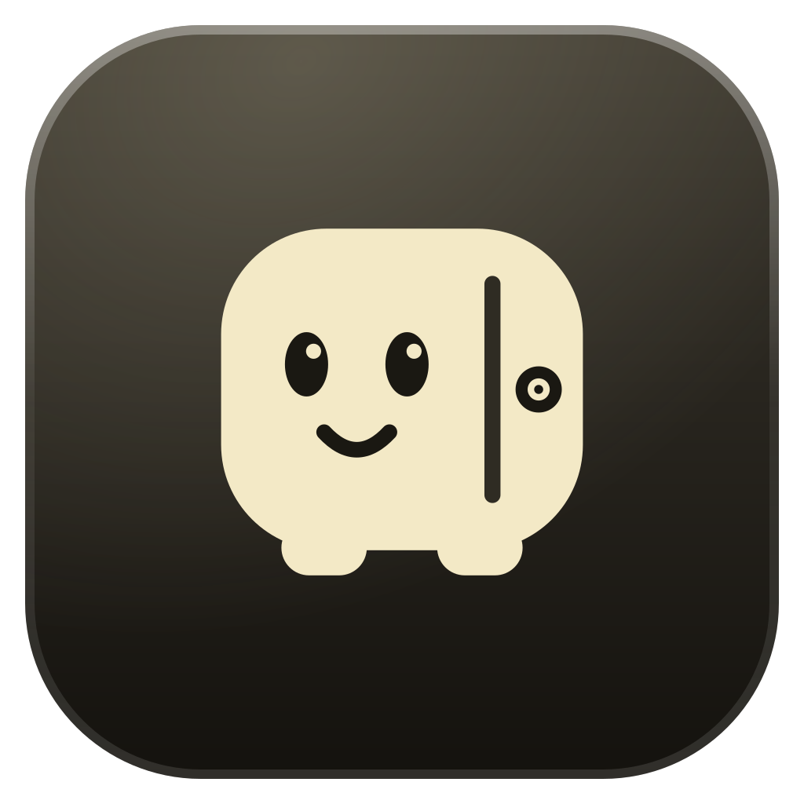
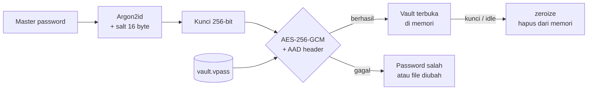

<div align="center">



# VaultPass

**Password manager desktop yang offline. Tanpa cloud, tanpa akun, dan datamu tetap di komputermu.**

[](https://github.com/mrizalbasri/vaultpass/actions/workflows/ci.yml)
[](LICENSE)


</div>

---

## Apa itu VaultPass?

VaultPass menyimpan password akun dan API key dalam satu file terenkripsi di komputermu. Kuncinya satu **master password** yang tidak pernah disimpan di mana pun. Aplikasi ini dibuat dengan Tauri, Rust, dan React, dan berjalan sepenuhnya offline.

Ada satu fitur yang jarang ditemui di password manager lain: **AI Agent bisa memakai API key tanpa kamu menempelkan key mentah ke chat**. Agent menjalankan perintah CLI, kamu menyetujuinya dengan Windows Hello, dan key hanya masuk ke proses yang diminta.

> **Status: pre-release.** Aplikasi berjalan dan teruji dasar, tapi belum diaudit pihak ketiga dan belum ada installer. Pertimbangkan hal itu sebelum menyimpan data yang sangat penting.

## Fitur

**Keamanan**
- Enkripsi **AES-256-GCM** dengan kunci dari **Argon2id**
- Kunci dan data dihapus dari memori saat vault dikunci (`zeroize`)
- Penyimpanan atomik dengan salinan `.bak` otomatis, jadi file tidak rusak saat penyimpanan terputus
- Buka vault dengan **Windows Hello** (sidik jari atau PIN), kuncinya dilindungi Windows DPAPI

**Pemakaian harian**
- Akun login dan **API key** dalam satu tempat, dengan kategori, favorit, dan pencarian cepat (`Ctrl+K`)
- Generator password memakai CSPRNG milik sistem operasi
- Indikator kekuatan password, dan penanda password yang lemah atau dipakai ulang
- **Auto-lock** saat idle dengan hitung mundur dan peringatan 30 detik sebelum terkunci
- Clipboard dibersihkan otomatis setelah menyalin secret
- Ekspor dan impor backup terenkripsi (`.vpass`), serta lokasi file vault yang bisa kamu pilih sendiri
- Pengingat master password (opsional) di layar login

**Untuk AI Agent**
- CLI `vaultpass-cli` untuk membaca atau menyuntikkan secret ke environment variable, dijaga Windows Hello

## Cara kerja keamanan

| Aspek | Detail |
|---|---|
| Derivasi kunci | Argon2id, `m = 64 MiB`, `t = 3`, `p = 4`, salt acak 16 byte |
| Enkripsi | AES-256-GCM, nonce acak 12 byte yang baru di setiap penyimpanan |
| Integritas | Header file (versi, parameter KDF, salt, cipher) ikut diautentikasi sebagai AAD, jadi mengubah header membuat dekripsi gagal |
| Memori | `zeroize` menghapus kunci dan payload saat vault dikunci |
| Penyimpanan | Tulis ke `.vpass.tmp`, sinkronkan ke disk, salin yang lama ke `.vpass.bak`, lalu ganti `vault.vpass` |
| Biometrik | Kunci vault dibungkus Windows DPAPI dan hanya dibuka setelah verifikasi Windows Hello |



**Yang tidak dilindungi:**
- Malware atau pengintai di komputer yang sedang dalam keadaan terbuka
- Master password yang hilang. Tidak ada cara memulihkannya, karena password itu tidak disimpan di mana pun

Untuk melaporkan kerentanan, lihat [SECURITY.md](SECURITY.md).

## Akses AI Agent lewat CLI

`vaultpass-cli` memungkinkan AI Agent memakai key dari vault dengan persetujuanmu. Fitur ini perlu diaktifkan dulu di **Pengaturan → Windows Hello**.

```powershell
# Daftar item (opsional: cari dengan kata kunci)
vaultpass-cli list --query openai

# Baca satu nilai: password | key | username | url | env | notes | json
vaultpass-cli get "OpenAI" --field key

# Jalankan perintah dengan key disuntikkan ke environment variable,
# tanpa key tampil di log atau chat
vaultpass-cli run --key "OpenAI" --env OPENAI_API_KEY -- python test_api.py
```

Panel detail di aplikasi untuk item bertipe API Key sudah menyiapkan perintah ini dan bisa disalin dengan satu klik.

## Memulai

**Prasyarat:** Windows 10/11 dengan WebView2, Node.js 22+, Rust stable, dan [prasyarat Tauri v2](https://v2.tauri.app/start/prerequisites/) untuk Windows.

> Backend memakai Windows DPAPI dan Windows Hello, jadi aplikasi saat ini **hanya berjalan di Windows**.

```bash
git clone https://github.com/mrizalbasri/vaultpass.git
cd vaultpass
npm install
npm run tauri dev
```

Membangun installer:

```bash
npm run tauri build
```

## Pengujian

```bash
npm run build                      # typecheck + build frontend

cd src-tauri
cargo fmt --check                  # format
cargo clippy --all-targets -- -D warnings
cargo test --lib                   # enkripsi, penyimpanan, dan generator password
```

CI menjalankan semua pemeriksaan di atas pada setiap pull request.

## Struktur proyek

```text
vaultpass/
├── src/                      # Frontend React + Tailwind v4
│   ├── App.tsx               # layout tiga panel
│   ├── index.css             # design token (warna, font, animasi)
│   ├── components/           # LockScreen, SessionTimer, VaultMascot, modal
│   └── utils/
├── src-tauri/                # Backend Rust (Tauri 2)
│   ├── src/
│   │   ├── crypto.rs         # Argon2id, AES-256-GCM, generator password
│   │   ├── vault.rs          # format vault, penyimpanan atomik
│   │   ├── biometric.rs      # Windows Hello + DPAPI
│   │   ├── lib.rs            # command Tauri
│   │   └── bin/vaultpass_cli.rs
│   └── icons/source/         # sumber logo (SVG)
└── .github/                  # CI, Dependabot, template issue dan PR
```

## Status dan rencana

Sudah ada: enkripsi vault, Windows Hello, CLI untuk AI Agent, auto-lock dengan peringatan, backup terenkripsi, dan CI dengan coverage.

Belum ada:
- Installer dan rilis resmi
- Jeda (cooldown) setelah beberapa percobaan password salah
- Tes untuk lapisan command Tauri dan untuk frontend
- Dukungan macOS dan Linux

## Berkontribusi

Kontribusi sangat disambut. Baca [CONTRIBUTING.md](CONTRIBUTING.md) untuk cara setup dan alur PR, dan [Kode Etik](CODE_OF_CONDUCT.md) untuk aturan bersama.

## Lisensi

[MIT](LICENSE) © 2026 M. Rizal Basri
