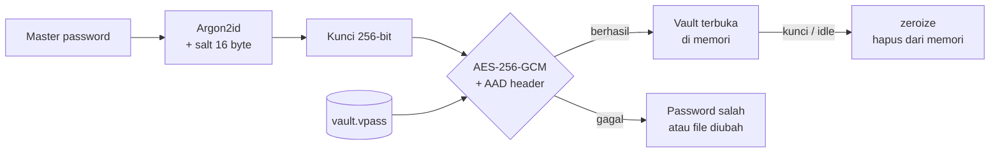

<div align="center">


# VaultPass

**Password manager desktop yang offline. Tanpa cloud, tanpa akun, dan datamu tetap di komputermu.**

[](https://github.com/mrizalbasri/vaultpass/actions/workflows/ci.yml)
[](LICENSE)


</div>

---

## Apa itu VaultPass?

VaultPass menyimpan password akun dan API key dalam satu file terenkripsi di komputermu. Kuncinya satu **master password** yang tidak pernah disimpan di mana pun. Aplikasi ini dibuat dengan Tauri, Rust, dan React, dan berjalan sepenuhnya offline.

Ada satu fitur yang jarang ditemui di password manager lain: **AI Agent bisa memakai API key tanpa kamu menempelkan key mentah ke chat**. Agent menjalankan perintah CLI, kamu menyetujuinya dengan Windows Hello, dan key hanya masuk ke proses yang diminta.

> **Status: pre-release.** Aplikasi berjalan dan teruji dasar, tapi belum diaudit pihak ketiga dan belum ada installer. Pertimbangkan hal itu sebelum menyimpan data yang sangat penting.

## Fitur

**Keamanan**
- Enkripsi **AES-256-GCM** dengan kunci dari **Argon2id** (dengan batas aman parameter KDF terhadap file eksternal)
- Kunci dan payload dihapus dari memori Rust saat vault dikunci (`zeroize`), dan daftar item di UI tidak menahan seluruh password/secret di memori JavaScript WebView
- Penyimpanan atomik dengan salinan `.bak` otomatis (ikut dienkripsi ulang dengan nonce baru saat ganti master password)
- Clipboard dibersihkan otomatis dan ditandai agar tidak terekam di **Windows Clipboard History (`Win+V`)** maupun Cloud Clipboard
- Buka vault dengan **Windows Hello** (sidik jari, wajah, atau PIN) tanpa fallback dialog biasa; kunci dibungkus Windows DPAPI + entropi acak di Windows Credential Manager

**Pemakaian harian**
- Akun login dan **API key** dalam satu tempat, dengan kategori, favorit, dan pencarian cepat (`Ctrl+K`)
- Generator password memakai CSPRNG milik sistem operasi
- Indikator kekuatan password, dan penanda password yang lemah atau dipakai ulang
- **Auto-lock** saat idle dengan hitung mundur dan peringatan 30 detik sebelum terkunci
- Ekspor dan impor backup terenkripsi (`.vpass`), serta lokasi file vault yang bisa kamu pilih sendiri (default di `%LOCALAPPDATA%\com.rizal.vaultpass\vault.vpass`)
- Pengingat master password (opsional) di layar login

**Untuk AI Agent**
- CLI `vaultpass-cli` khusus kategori **API Key** (akun `Login`/`Finance` tetap terisolasi dari CLI) dengan pencocokan nama/ID persis dan persetujuan Windows Hello

## Cara kerja keamanan

| Aspek | Detail |
|---|---|
| Derivasi kunci | Argon2id, `m = 64 MiB` (batas validasi `8 MiB – 1 GiB`), `t = 3`, `p = 4`, salt acak 16 byte |
| Enkripsi | AES-256-GCM, nonce acak 12 byte yang baru di setiap penyimpanan |
| Integritas | Header file (versi, parameter KDF, salt, cipher) ikut diautentikasi sebagai AAD, jadi mengubah header membuat dekripsi gagal |
| Memori & IPC | `zeroize` menghapus kunci dan payload di Rust saat vault dikunci; penyalinan secret dilakukan langsung dari Rust ke clipboard tanpa melewati JavaScript |
| Clipboard | Menyertakan flag `ExcludeClipboardContentFromMonitorProcessing`, `CanIncludeInClipboardHistory=0`, dan `CanUploadToCloudClipboard=0` |
| Penyimpanan | Tulis ke `.vpass.tmp`, sinkronkan ke disk, salin ke `.vpass.bak`, lalu ganti `vault.vpass` (saat rotasi master password, `.vpass.bak` juga langsung dienkripsi ulang) |
| Biometrik | Verifikasi paksa via Windows Hello (`IUserConsentVerifierInterop`), kunci dibungkus Windows DPAPI + entropi 32 byte di Windows Credential Manager |



**Yang tidak dilindungi:**
- Malware atau eksekusi kode tak tepercaya di akun pengguna Windows yang sama. Saat fitur Windows Hello diaktifkan pada aplikasi desktop *unpackaged*, kunci dibungkus menggunakan DPAPI tingkat akun pengguna Windows — fitur `vaultpass-cli` dirancang sebagai *consent guardrail* agar secret tidak bocor ke log chat/riwayat terminal, bukan isolasi terhadap proses lokal berbahaya yang berjalan sebagai akun Windows milikmu sendiri.
- Master password yang hilang. Tidak ada cara memulihkannya, karena password itu tidak disimpan di mana pun

Untuk melaporkan kerentanan, lihat [SECURITY.md](SECURITY.md).

## Akses AI Agent lewat CLI

`vaultpass-cli` memungkinkan AI Agent memakai item berkategori **API Key** dari vault dengan persetujuanmu (item `Login`, `Finance`, dan kategori lain tidak dapat diakses lewat CLI). Jika **Windows Hello** diaktifkan di **Pengaturan & Keamanan**, persetujuan menggunakan Sidik Jari/Wajah/PIN; jika Windows Hello belum aktif di perangkat, CLI otomatis memunculkan dialog **Windows Security (Master Password)**.

```powershell
# Daftar item kategori API Key (opsional: cari dengan kata kunci)
vaultpass-cli list --query openai

# Jalankan perintah dengan key disuntikkan ke environment variable,
# tanpa key tampil di log atau chat (vault dihapus dari memori sebelum proses anak jalan)
vaultpass-cli run --key 'OpenAI' --env 'OPENAI_API_KEY' -- python test_api.py

# Baca satu nilai secara eksplisit: key | password | username | url | env | notes | json
vaultpass-cli get 'OpenAI' --field key
```

Panel detail di aplikasi untuk item bertipe API Key sudah menyiapkan perintah ini dan bisa disalin dengan satu klik.

## Memulai

> Aplikasi memakai Windows DPAPI, Windows Hello, dan Win32 Clipboard, jadi saat ini **khusus Windows 10/11 (64-bit)**.

### 1. Install Cepat lewat PowerShell (Aplikasi Desktop + `vaultpass-cli`)

Perintah ini mengunduh rilis terbaru dari [GitHub Releases](https://github.com/mrizalbasri/vaultpass/releases), memverifikasi checksum `SHA-256`, memasang VaultPass, dan otomatis mendaftarkan `vaultpass-cli` ke `PATH`:

```powershell
irm https://raw.githubusercontent.com/mrizalbasri/vaultpass/main/install.ps1 | iex
```

Atau unduh manual **`VaultPass_*_x64-setup.exe`** (maupun versi `*_portable.zip`) langsung dari halaman [Releases](https://github.com/mrizalbasri/vaultpass/releases).

### 2. Menjalankan dari Kode Sumber (Developer)

**Prasyarat:** Windows 10/11 dengan WebView2, Node.js 22+, Rust stable, dan [prasyarat Tauri v2](https://v2.tauri.app/start/prerequisites/) untuk Windows.

```bash
git clone https://github.com/mrizalbasri/vaultpass.git
cd vaultpass
npm install
npm run tauri:dev
```

Membangun installer (otomatis ikut memaketkan `vaultpass-cli.exe` ke dalam installer `.msi` & `-setup.exe`):

```bash
npm run tauri:build
```

## Pengujian

```bash
npm run build                      # typecheck + build frontend

cd src-tauri
cargo fmt --check                  # format
cargo clippy --all-targets -- -D warnings
cargo test                         # enkripsi, penyimpanan, clipboard, biometrik, dan CLI
```

CI menjalankan semua pemeriksaan di atas pada setiap pull request.

## Struktur proyek

```text
vaultpass/
├── src/                      # Frontend React + Tailwind v4
│   ├── App.tsx               # layout tiga panel
│   ├── index.css             # design token (warna, font, animasi)
│   ├── components/           # LockScreen, SessionTimer, VaultMascot, modal
│   └── utils/
├── src-tauri/                # Backend Rust (Tauri 2)
│   ├── src/
│   │   ├── crypto.rs         # Argon2id, AES-256-GCM, generator password
│   │   ├── vault.rs          # format vault, validasi env, penyimpanan atomik
│   │   ├── biometric.rs      # Windows Hello + DPAPI + Credential Manager
│   │   ├── clipboard.rs      # clipboard Win32 + eksklusi Clipboard History
│   │   ├── lib.rs            # command Tauri
│   │   └── bin/vaultpass_cli.rs
│   └── icons/source/         # sumber logo (SVG)
├── scripts/                  # skrip build sidecar CLI & render ikon
└── .github/                  # CI, Dependabot, template issue dan PR
```

## Status dan rencana

Sudah ada: enkripsi vault, Windows Hello, CLI untuk AI Agent, auto-lock dengan peringatan, backup terenkripsi, dan CI dengan coverage.

Belum ada:
- Installer dan rilis resmi
- Jeda (cooldown) setelah beberapa percobaan password salah
- Tes untuk lapisan command Tauri dan untuk frontend
- Dukungan macOS dan Linux

## Berkontribusi

Kontribusi sangat disambut. Baca [CONTRIBUTING.md](CONTRIBUTING.md) untuk cara setup dan alur PR, dan [Kode Etik](CODE_OF_CONDUCT.md) untuk aturan bersama.

## Lisensi

[MIT](LICENSE) © 2026 M. Rizal Basri
